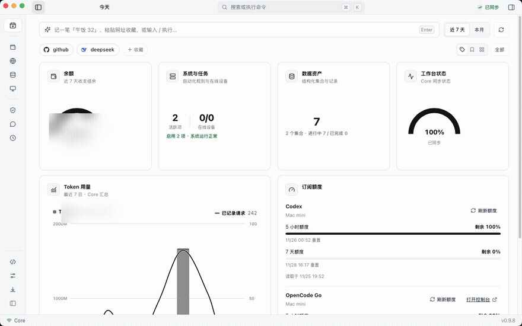
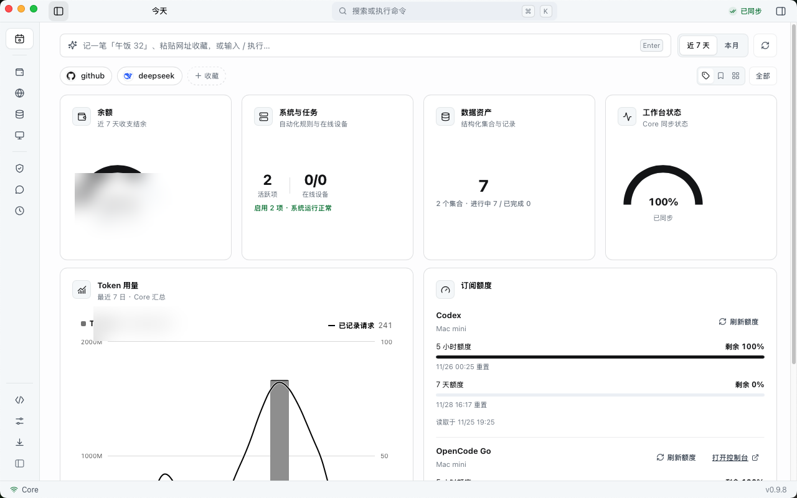
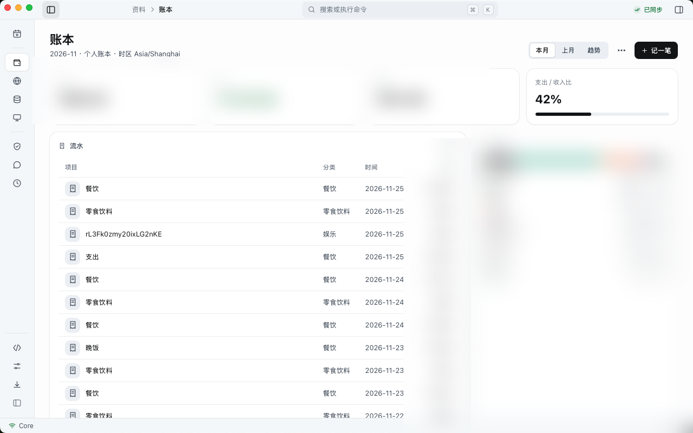
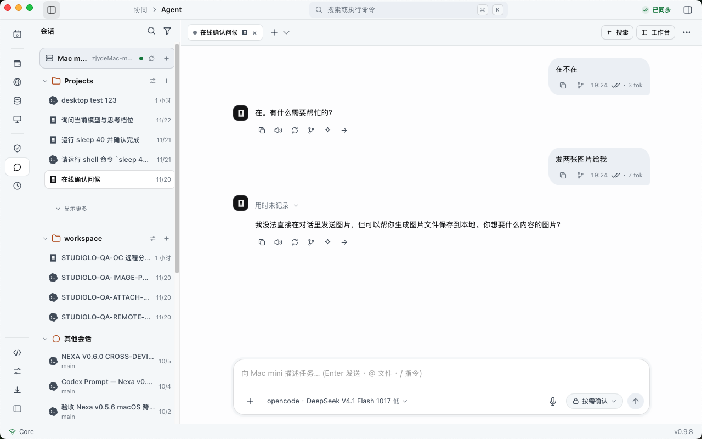
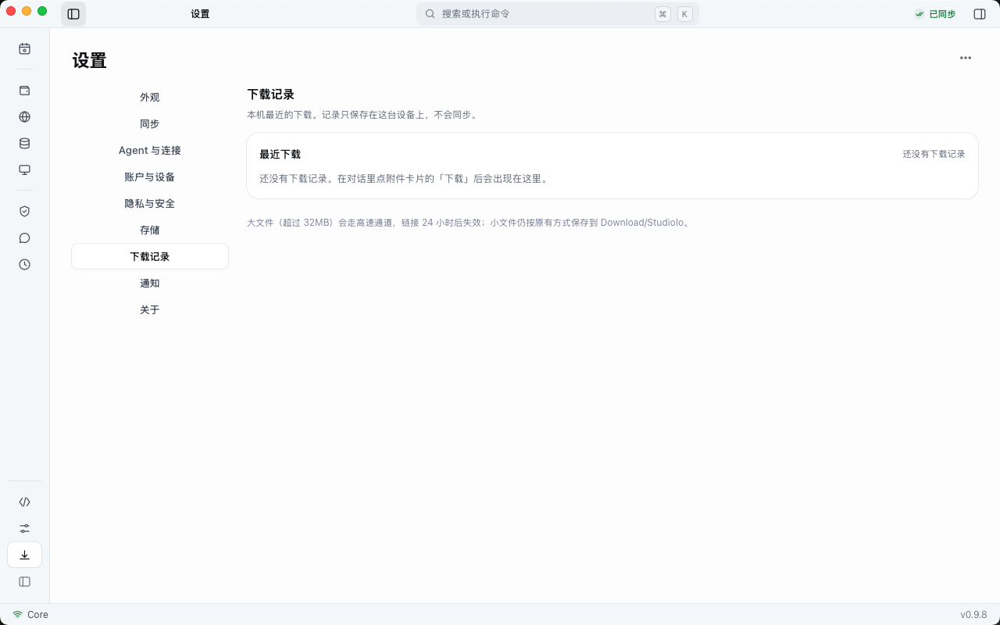

# Studiolo 🛋️

这是一个把「记账 / 收藏 / 文件 / 和 AI 助手对话」装进一个窗口的私人控制台，电脑手机都能用。  
告别十几个凌乱的网页与标签页，泡一杯咖啡，所有数字家当都在手边。

## 🎬 先睹为快

  
*像随手翻开一本精致手账，点到哪翻到哪，丝滑切换不卡壳*

## 💡 它能干什么

### 1. 今天
一屏看完账户余额、待办清单、设备在线状态与助手额度。每天早晨看一眼，今天要做什么、还剩多少家底，心里明明白白。  
  
*一目了然的仪表盘，收支、待办、设备在线状态全收在眼底*

### 2. 账本
买杯奶茶记一笔只要三秒，输个数字随手选个分类。月底自动按分类算账，再也不用抓耳挠腮对着账单算半天。  
  
*记一笔只要三秒，月底自动按分类算账，省去对账烦恼*

### 3. 和 AI 助手对话
左边挑会话，右边直接派活。聊天记录安稳留在自己设备上不落中心库；就算突然断网、切页面甚至重启电脑，说一半的话和任务也绝不弄丢。  
  
*随叫随到的私人助手，左边挑会话右边派活，断网重启消息都不丢*

### 4. 多台电脑，一个入口
家里那台 Mac 和公司那台 Windows 上都跑着助手？在这一个窗口里就能顺手指挥，再也不用来回换座或折腾复杂的远程连接。

### 5. 文件和大文件
日常小文件直接存本地私密保险箱，附件加密更安心；偏大文件自动走高速通道，专属下载链接 24 小时内随时取用，省心不卡顿。  
  
*小文件存本地私密保险箱，大文件走高速通道，链接 24 小时随时取*

### 6. 跨设备
窝在沙发上掏出手机，也能看同一份账本和刚才没聊完的会话。换了设备，生活和思路依然严丝合缝接得上。

## 🥊 能解决什么烦恼

| 以前的烦恼 | 现在的舒心 |
|---|---|
| 聊到一半断网或误关页面，大段思路瞬间蒸发 | 聊天记录留在自己设备上不落中心库，断网重启一句不落 |
| 手机上想接着电脑上的活，换台机器又得重新翻找传文件 | 一个入口指挥家里 Mac 和公司 Windows，换设备无缝接力 |
| 查余额开银行、记日常开便签、找资料开网盘，屏幕堆满窗口 | 记账、收藏、文件与助手齐聚一堂，一屏看全个人日常 |
| 传个稍大点的文件总在转圈，过两天再看链接早已过期失效 | 小文件直接安家本地，大文件走专属高速通道，24 小时随取 |

## 📦 怎么装

挑你手头的设备，下载对应安装包即可：

| 平台 | 安装包 | 一句话要点 |
|---|---|---|
| macOS | `Studiolo_0.9.9_x64.dmg` | 拖入 Applications；首次若提示“无法验证开发者”，右键点「打开」即可 |
| Windows | `Studiolo_0.9.9_x64-setup.exe` | 双击运行；若弹蓝底防护提示，点「更多信息」→「仍要运行」 |
| Android | `Studiolo_0.9.9_universal.apk` | 传到手机直接安装，按提示开启「允许未知来源」后直接打开 |

> 详细步骤（含截图）见 [使用指南](./docs/使用指南.md)

## 🚪 传送门

日子已经够忙碌了，数字生活还是清爽简单点好。

- **当前版本**：`0.9.9`
- **想深挖技术细节？** 欢迎移步至 [技术版文档](./docs/README-技术版.md)
