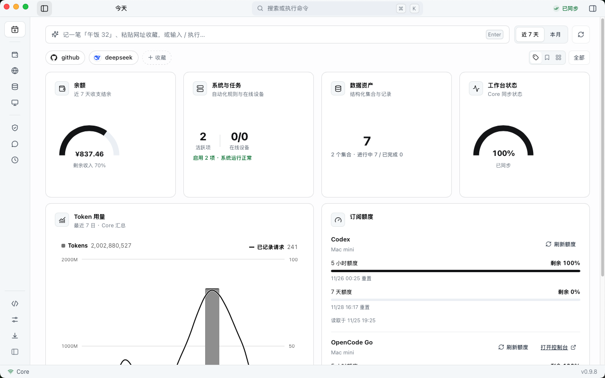
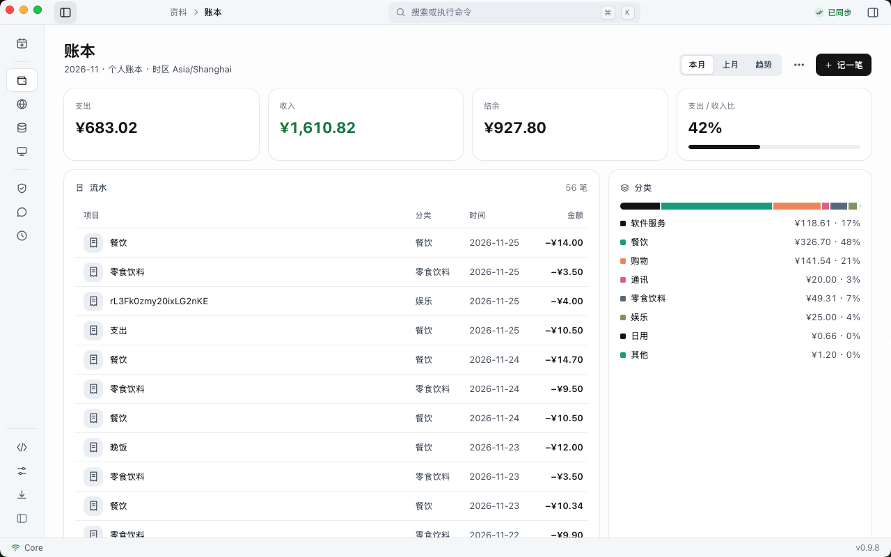
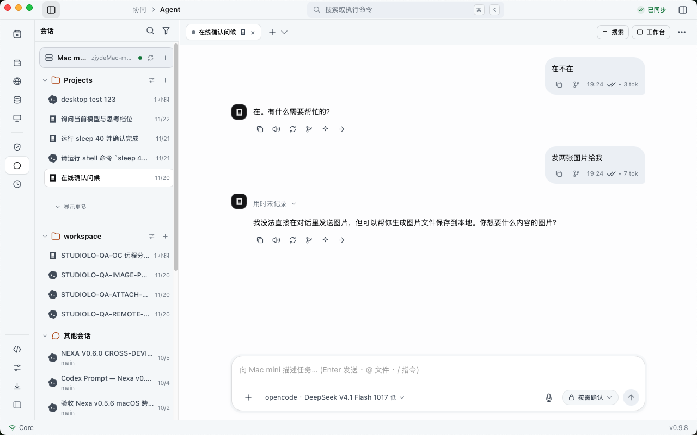
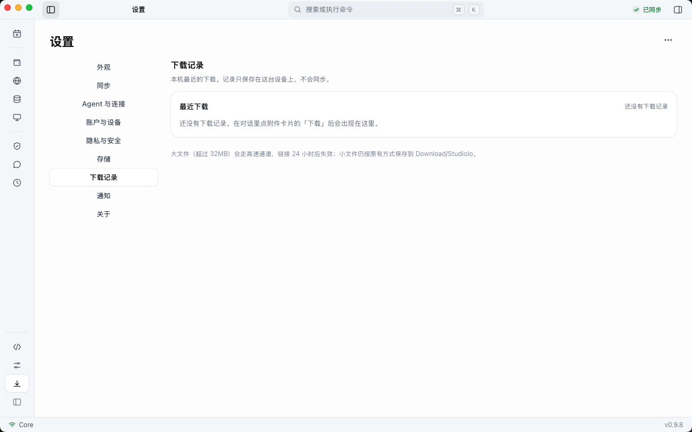
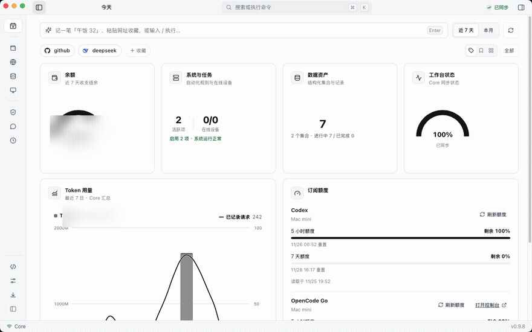

# Studiolo 轻松上手指南

Studiolo 是你的个人数字控制台：记账、收藏、文件、和 AI 助手对话，手机上也能看。

---

## 📦 三步搞定软件安装

不管你用苹果电脑、Windows 还是安卓手机，照着表格点几下就行：

| 平台 | 安装包 | 安装要点 |
|---|---|---|
| Mac | `Studiolo_0.9.9_x64.dmg` | 拖进 Applications 文件夹；首次若提示“无法验证开发者”，**右键 → 打开**，或去「系统设置 → 隐私与安全性」点「仍要打开」 |
| Windows | `Studiolo_0.9.9_x64-setup.exe`（或 `.msi`） | 双击运行；若弹 SmartScreen 蓝底提示，点**「更多信息」→「仍要运行」** |
| Android | `Studiolo_0.9.9_universal.apk` | 传到手机后点击安装，按提示开启**“允许安装未知来源应用”**，装完直接打开 |

> 💡 **为什么系统会多问一句？**  
> 这几个包都是自家手工打包的，没有去大公司买高昂的认证贴纸。系统碰到自签名应用多问一句属正常现象，绝对不是病毒，放心点继续就好！

---

## 🔑 第一次打开：认识你的保险箱

首次启动软件时，屏幕通常会弹出一个「钥匙串」授权框。

别犹豫，**点「始终允许」，输入一次电脑开机密码**。

这相当于你的系统保险箱要确认是你本人，不是别人在乱翻私密内容。输入这一次密码后，系统就会默默记住，以后再也不会打扰你。随后便会顺利进入「今天」页面。

---

## 🧭 五个日常使用场景

Studiolo 平时怎么用？带你看看最常用的五个场景：

### 1. 汽车仪表盘一般的「今天」

每天一打开软件，迎面而来的就是全貌仪表盘。就像汽车仪表盘展示车速与油量，各项动态一眼望尽：

  
*一打开就能看到的全貌，收支、任务、用量一目了然*

| 仪表盘区域 | 展示内容 | 日常作用 |
|---|---|---|
| 本月收支 | 结余、收入、支出与比例 | 掌握当月财务余额，花钱心里有底 |
| 系统与任务 | 连线设备与待办事务 | 确认家里或工位的电脑是否在线接单 |
| 数据资产 | 收藏总数与活跃便签 | 盘点日常整理的知识与资料条目 |
| 对话额度 | 字数消耗与订阅配额 | 查看 AI 助手的说话用量，合理安排提问 |

### 2. 随手记上一笔的「账本」

记账不用繁琐步骤。打开账本，输个数字、随手选个标签，三秒搞定。

  
*清爽直观的记账界面，点几下就能记上一笔，月底自动统计分类*

月底打开看一眼分类饼图，哪类开销花得最多清清楚楚。

### 3. 随叫随到的「AI 助手」

想写文章、做攻略或者整理摘要？随时找左侧列表里的 AI 助手聊聊天。

  
*左边挑选对话主题，右边畅快聊天，有什么活尽管交给它*

左边是会话列表，右边是聊天窗口。和它自然对话，让它替你干活。

### 4. 井井有条的「下载记录」

聊天中收到的文件附件，随时可以在设置里的「下载记录」翻找。

  
*下载过的东西都在这儿，大文件自动走高速通道*

| 文件规格 | 分流方式 | 保存位置与有效期 |
|---|---|---|
| 普通小文件（32MB 以下） | 常规通道 | 直接存到本机的「下载」文件夹，永久保留 |
| 偏大文件（超过 32MB） | 高速通道 | 生成专属高速链接，24 小时内随时打开下载 |

---

## 🏃 随手逛逛：丝滑切换不卡壳

软件内部切换极为顺畅，点到哪里就翻到哪里：

  
*几秒内流畅切换不同板块，就像随手翻开一本精致手账*

从仪表盘到记账本，再跳到助手聊天，无缝衔接，丝毫没有拖泥带水的感觉。

---

## ❓ 常见小疑问答疑

遇到小困惑？来看这几条解答：

- **问：为什么总弹钥匙串授权框？**  
  **答：** 点击「始终允许」，输入一次开机密码，以后系统就认得你了，不再弹窗。
- **问：助手提示“额度用完了”怎么办？**  
  **答：** 可以在会话上方换个模型继续聊，或者稍等片刻，界面上会写明额度恢复时间。
- **问：左边为什么显示“没有在线节点”？**  
  **答：** 说明另一台当帮手的电脑没开着 Studiolo，过去把那台电脑打开运行即可。
- **问：手机上找不到之前的某个会话？**  
  **答：** 点右上角漏斗筛选按钮，把“已归档”勾选打开，历史话题就全出来了。
- **问：下载的文件到底保存在哪儿了？**  
  **答：** 小文件在系统默认的「下载」文件夹里，大文件链接在 24 小时内随时有效。

---

## 🎉 开始探索吧

五分钟上手，属于你的专属控制台就已准备就绪。快去开启第一场对话、记下第一笔账吧！

当前版本：`0.9.9`
